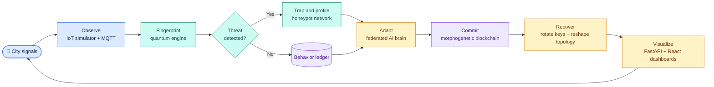
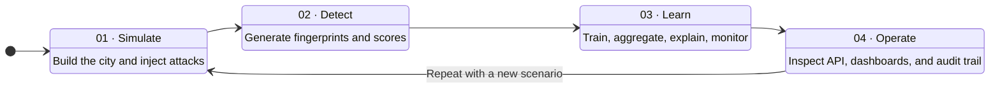
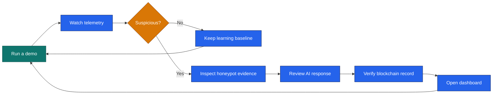
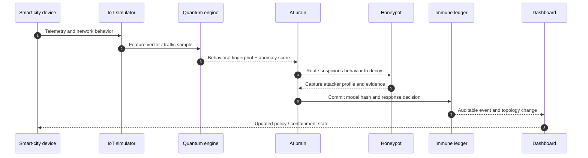
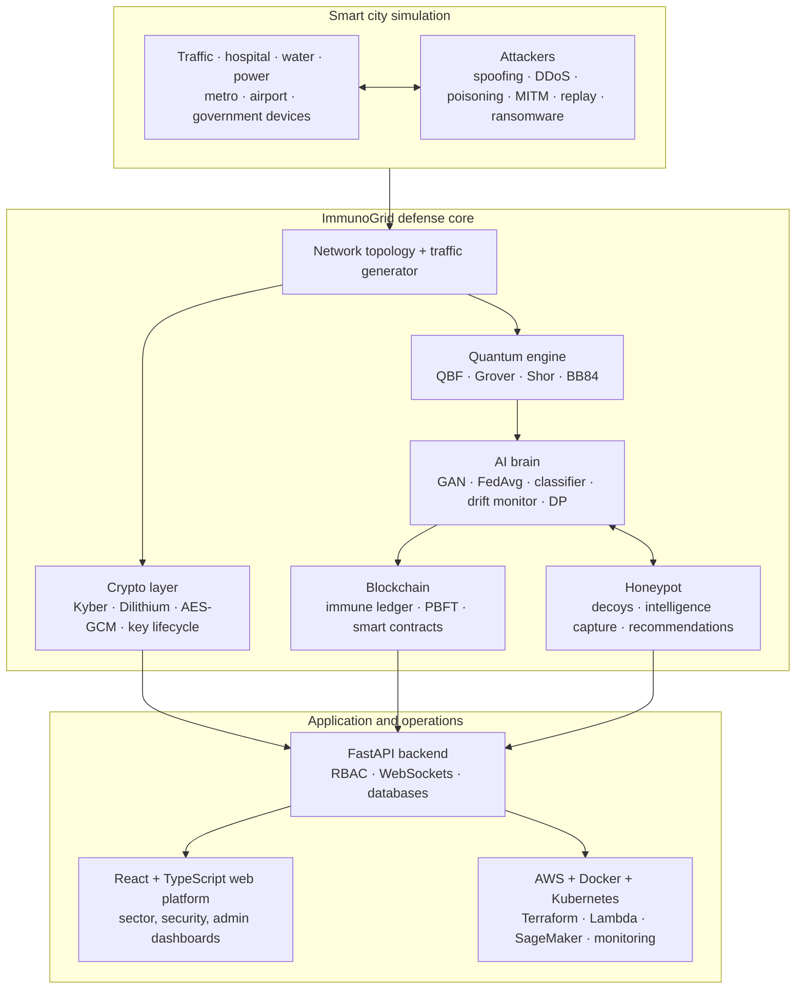

# 🛡️ ImmunoGrid

> **A bio-inspired, self-evolving cyber-defense research platform for smart-city IoT.**
>
> Quantum behavioral fingerprinting · Federated adversarial intelligence · Post-quantum cryptography · Morphogenetic blockchain

<p align="center">
  
  
  
  
</p>

<p align="center">
  <a href="SETUP.md">Setup guide</a> ·
  <a href="CHANGELOG.md">Changelog</a> ·
  <a href="paper/main.tex">Research paper</a> ·
  <a href="frontend/README.md">Frontend</a> ·
  <a href="backend/README.md">Backend</a>
</p>

## 🌆 The idea in one minute

ImmunoGrid models a city as a living defensive system. Sensors provide signals, the quantum engine learns behavioral fingerprints, the AI brain classifies and rehearses attacks, the honeypot collects intelligence, and the blockchain records decisions that need an auditable history. The platform is designed to **observe, reason, adapt, and recover** across connected city sectors.

This repository is a research and demonstration platform, not a production security certification. The algorithms include simulators and experimental implementations so that the ideas can be benchmarked, visualized, and extended.

## 🎬 Animated defense loop

The diagrams below use Mermaid to create a modern, animated-style visual language. GitHub renders them as interactive diagrams; Mermaid-compatible presentation tools can animate the flow arrows to show the continuous defense loop.



## 🧭 How to work with ImmunoGrid

Think of the project as four connected workspaces. Start with a simulation, inspect the evidence, then move toward the API and dashboards when the behavior makes sense.



| Stage | What you do | Start here | What you learn |
|---|---|---|---|
| **01 · Simulate** | Create devices, topology, traffic, and attack scenarios. | `python start.py sim` | How a smart-city network behaves under normal and hostile conditions. |
| **02 · Detect** | Run quantum fingerprints and threat classification. | `python start.py quantum` | How behavioral features become anomaly evidence. |
| **03 · Learn** | Run federated training, drift checks, explainability, and privacy controls. | `python ai_brain/test_ai_brain_complete.py` | How the defense adapts without treating every event as a fixed rule. |
| **04 · Operate** | Start the API and frontend, then inspect live state and audit events. | `uvicorn main:app --reload` | How research outputs become role-aware operational views. |

### ⚡ The shortest useful walkthrough



The command sequence behind that visual is:

```bash
# 1. Create activity
python start.py demo

# 2. Run a focused attack scenario
python start.py attack

# 3. Run subsystem verification
python test_integration.py

# 4. Open the operational layer
cd backend
uvicorn main:app --reload --port 8000
```

### 🧭 How a signal becomes a defense decision



## 🧠 What makes the project different?

| Research idea | What it does | Why it matters |
|---|---|---|
| **Quantum Behavioral Fingerprinting** | Encodes device behavior into a compact fingerprint and compares it with learned patterns. | Detects changes in behavior, not only known signatures. |
| **Federated Adversarial Consciousness** | Trains defender and attacker models locally, then aggregates useful updates. | Simulates an adversary that learns as the defense learns. |
| **Morphogenetic Blockchain** | Stores trusted events, model commitments, and topology adaptations. | Gives distributed decisions an auditable memory. |
| **Post-quantum crypto layer** | Combines Kyber-512, AES-256-GCM, Dilithium-2, and PQC-TLS simulations. | Explores confidentiality and authenticity after quantum threats. |
| **Intelligent honeypots** | Spawns decoys and extracts attacker behavior for future training. | Turns hostile activity into defensive intelligence. |

## 🏗️ System architecture



## 🧩 Repository map

| Area | Responsibility | Key entry points |
|---|---|---|
| [`iot_simulator/`](iot_simulator/) | Builds a realistic hybrid mesh/star city, virtual devices, attacks, and labeled traffic. | `city_builder.py`, `scenario_runner.py` |
| [`quantum_engine/`](quantum_engine/) | Runs behavioral fingerprints, attack simulations, QKD, and quantum benchmarks. | `fingerprint_gen.py`, `quantum_key_distribution.py` |
| [`crypto_layer/`](crypto_layer/) | Provides hybrid encryption, key management, signatures, secure channels, and benchmarks. | `hybrid_crypto.py`, `key_manager.py` |
| [`ai_brain/`](ai_brain/) | Trains, aggregates, evaluates, explains, and monitors defensive models. | `fl_coordinator.py`, `threat_classifier.py` |
| [`blockchain/`](blockchain/) | Simulates the immune ledger, consensus, smart contracts, and Web3 bridge. | `immune_ledger.py`, `consensus.py` |
| [`honeypot/`](honeypot/) | Creates decoys, captures intelligence, and produces response recommendations. | `decoy_spawner.py`, `intelligence_capture.py` |
| [`backend/`](backend/) | Exposes the platform through FastAPI routers, services, persistence, RBAC, and live feeds. | `main.py`, `routers/`, `services/` |
| [`frontend/`](frontend/) | Hosts sector, security, administration, simulation, and live monitoring views. | `src/` |
| [`aws_infra/`](aws_infra/) | Defines AWS Lambda and Terraform infrastructure. | `lambda/`, `terraform/` |
| [`devops/`](devops/) | Contains Docker, Kubernetes, monitoring, and delivery assets. | `docker/`, `k8s/` |
| [`paper/`](paper/) | Contains the manuscript, bibliography, sections, and generated figures. | `main.tex`, `generate_figures.py` |

## 🔁 Data and response lifecycle

1. **Generate:** the simulator emits telemetry from 500+ virtual city devices and can inject six attack families.
2. **Measure:** the quantum engine transforms behavior into fingerprints and evaluates attack simulations.
3. **Protect:** the crypto layer secures messages, rotates keys, and models post-quantum handshakes.
4. **Learn:** local trainers create defender and attacker updates; the coordinator aggregates them without centralizing raw training data.
5. **Investigate:** honeypots isolate suspicious activity and capture useful attacker behavior.
6. **Remember:** the blockchain layer records model hashes, decisions, consensus results, and adaptive topology changes.
7. **Operate:** FastAPI services publish the state to role-aware dashboards and live WebSocket feeds.

## 📊 Current research surface

| Area | Documented result or capability |
|---|---|
| Quantum fingerprints | 4-qubit QBF: 95.8% accuracy; 8-qubit enhanced QBF: 98.2% accuracy |
| Threat classification | RandomForest benchmark: 99.75% on the synthetic dataset |
| Privacy | Gaussian differential privacy engine with ε = 1.0 and δ = 1e-5 |
| PQC overhead | PQC-TLS handshake simulation of approximately 0.35 ms overhead |
| Consensus | Four-node PBFT simulation with tolerance for one Byzantine fault |
| Platform | 19 frontend pages, 13 RBAC roles, 50+ API endpoints, and 14 API routers |
| Research outputs | IEEE-style LaTeX manuscript, six figures, and benchmark tables I–IV |

These figures are benchmark outputs for the included synthetic and simulated workloads. Reproduce them with the commands in [SETUP.md](SETUP.md) before comparing hardware, datasets, or configurations.

## 🚀 Quick start

### 1. Prepare Python

```bash
git clone <repo-url>
cd research-IUT
python -m venv venv

# Windows PowerShell
venv\Scripts\Activate.ps1

# Linux/macOS
# source venv/bin/activate

pip install -r requirements.txt
```

### 2. Run the demos

```bash
# From the repository root
python start.py sim       # Build and run the virtual city
python start.py attack    # Run an attack demonstration
python start.py quantum   # Run a quantum fingerprint demonstration
python start.py demo      # Run the full local demonstration
python system_orchestrator.py
```

### 3. Start the API and web platform

```bash
# Terminal 1: API
cd backend
uvicorn main:app --reload --port 8000
# API docs: http://localhost:8000/api/docs

# Terminal 2: frontend
cd frontend
npm install
npm run dev
# App: http://localhost:3000
```

For databases, MQTT, environment variables, AWS, Kubernetes, benchmarks, scenario names, and demo accounts, use the complete [setup guide](SETUP.md).

## ✅ Validate the platform

```bash
# Root integration suite
python test_integration.py

# Focused subsystem suites
python ai_brain/test_ai_brain_complete.py
python blockchain/test_blockchain_complete.py
python crypto_layer/test_crypto_complete.py
python quantum_engine/test_quantum_engine_complete.py
python honeypot/test_honeypot_complete.py

# Pytest discovery, when the environment is configured for it
pytest
```

## 👥 Role-aware operations

The platform models 13 roles: Super Admin, National Security Officer, City IT Manager, Traffic Ministry, Health Ministry, Water Authority, Energy Ministry, Blockchain Auditor, AI/ML Engineer, Quantum Analyst, DevOps Engineer, Field Technician, and Government Auditor. Each role maps to a different operational view, from city-sector status to model health, blockchain evidence, compliance, and deployment telemetry.

## 📚 Research and further reading

- [Complete setup guide](SETUP.md) — prerequisites, services, deployment, scenarios, and benchmarks.
- [Changelog](CHANGELOG.md) — release inventory and documented test counts.
- [Research manuscript](paper/main.tex) — methods, results, figures, and bibliography.
- [AI brain notes](ai_brain/README.md) — federated learning and adversarial modeling.
- [Quantum engine notes](quantum_engine/README.md) — fingerprints, QKD, and attack simulation.
- [Crypto layer notes](crypto_layer/README.md) — hybrid cryptography and key management.
- [Blockchain notes](blockchain/README.md) — ledger, contracts, consensus, and bridge.
- [Frontend guide](frontend/README.md) — web platform development.
- [Backend guide](backend/README.md) — API and service development.

## ⚠️ Scope and responsible use

ImmunoGrid is intended for controlled research, simulation, education, and internal prototyping. Do not connect experimental attack simulators or cryptographic components to systems you do not own or have explicit permission to test. Validate all security claims against independent datasets, threat models, peer review, and production-grade implementations before operational use.

## 📜 License

This research project is proprietary. All rights reserved.
© 2026 ImmunoGrid Research Team
